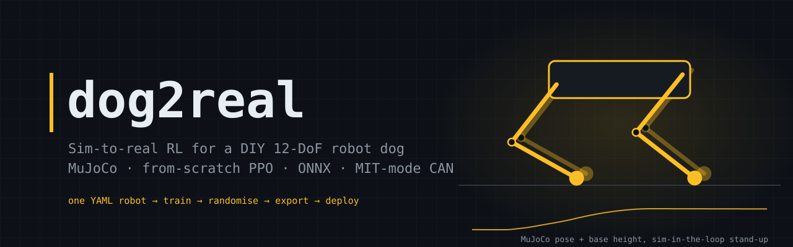
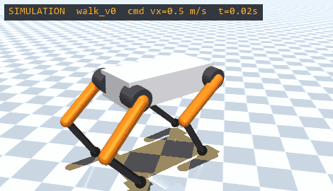
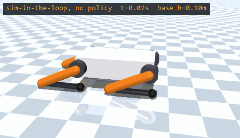
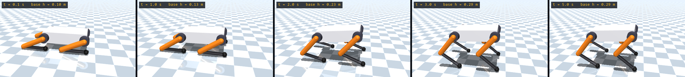
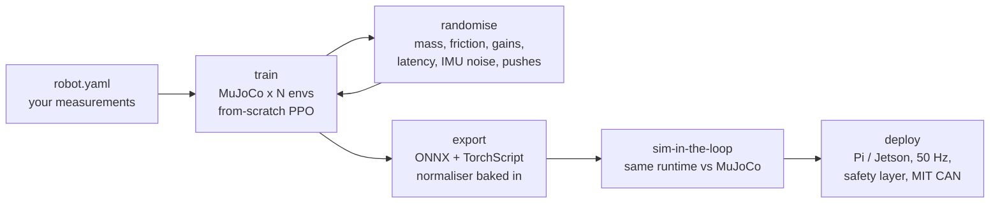
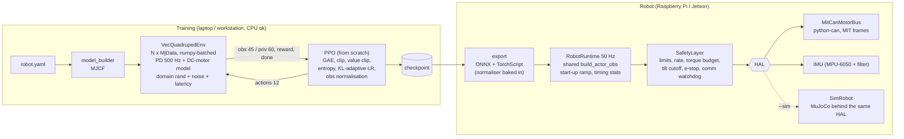
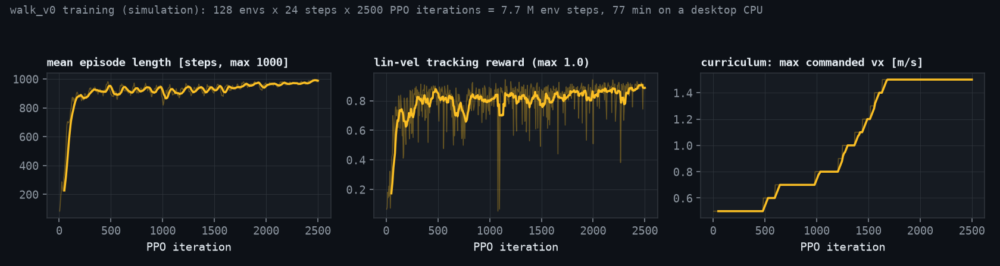

<p align="center">
  
</p>

<p align="center">
  <a href="https://github.com/coopersimpson101-debug/dog2real/actions/workflows/ci.yml"></a>
[](https://github.com/coopersimpson101-debug/dog2real/releases/latest)
  <a href="LICENSE"></a>
  
  
  
  
  
</p>

**Sim-to-real reinforcement learning for a DIY 12-DoF robot dog.** Describe your quadruped in one
YAML file, train a walking or get-up policy in MuJoCo with a from-scratch PPO, export it to ONNX,
and run it through a safety-checked 50 Hz runtime that you can validate against the simulator with
the *same code* before powering a single motor.

<p align="center">
  <a href="#quickstart">Quickstart</a> ·
  <a href="#architecture">Architecture</a> ·
  <a href="#sim-to-real-techniques">Sim-to-real</a> ·
  <a href="#results">Results</a> ·
  <a href="#status">Status</a> ·
  <a href="docs/match_your_robot.md">Match your robot</a> ·
  <a href="docs/deployment.md">Deployment</a>
</p>

<table>
  <tr>
    <td align="center" width="50%"></td>
    <td align="center" width="50%"></td>
  </tr>
  <tr>
    <td align="center"><sub><b>Simulation: policy trained 77 min on a desktop CPU.</b> The committed
    <a href="policies/walk_v0.pt"><code>policies/walk_v0.pt</code></a> tracking v<sub>x</sub> = 0.5 m/s
    (nominal physics, 0.09 m/s mean velocity error, 0 falls).</sub></td>
    <td align="center"><sub><b>Simulation: sim-in-the-loop stand-up, no policy.</b> The unchanged
    <code>RobotRuntime</code> + <code>SafetyLayer</code> drive MuJoCo through the hardware interface:
    lying → 0.285 m in a 3 s ramp, 0 safety faults.</sub></td>
  </tr>
</table>
<p align="center"><sub>Both clips are offscreen MuJoCo renders made by <code>docs/assets/make_figures.py</code>.
Nothing here has run on a physical robot yet.</sub></p>

## Highlights

- **Your robot, parameterised**: link lengths, masses, CoM, joint limits, motor torque-speed curve,
  armature, friction and PD gains live in [`configs/robot.yaml`](configs/robot.yaml); the MJCF is generated from it.
- **Readable, hand-written core**: PPO, GAE, env, rewards, domain randomisation, actuator model and
  deployment controller in plain PyTorch/numpy (~2.9 k lines, no stable-baselines / rl_games / Isaac).
- **Runs on a CPU**: vectorised MuJoCo envs batched in numpy, ~1-2 k env steps/s on one laptop core.
- **Sim-to-real built in**: DC-motor torque-speed model, 0-16 ms latency buffer, gain/strength/mass/friction/CoM
  randomisation, IMU bias + noise, pushes, asymmetric critic, one observation function shared by sim and robot.
- **Deployment you can trust**: ONNX/TorchScript export with round-trip checks (ONNX Runtime diff 6.0e-8),
  MIT-mode CAN driver for CubeMars AK motors, latched safety layer, and sim-in-the-loop with the real runtime.
- **A walking policy on a CPU budget**: 7.7 M env steps (77 min, 128 envs) gives a policy that tracks
  0.5 m/s at 0.08-0.11 m/s error with 0 falls, with and without domain randomisation (in simulation).
- **47 tests in ~15 s**, plus a CI smoke pipeline: train 3 iterations → export → sim-in-the-loop → motor sysid.

## Quickstart

```bash
git clone https://github.com/coopersimpson101-debug/dog2real && cd dog2real
pip install torch --index-url https://download.pytorch.org/whl/cpu && pip install -e ".[dev,video]"
pytest                                                                                  # 47 tests, ~15 s
python scripts/play.py --checkpoint policies/walk_v0.pt --command 0.5 0 0 --no-randomization  # pretrained walker
python scripts/run_robot.py --sim --policy policies/walk_v0.onnx --command 0.3 0 0 --duration 10  # sim-in-the-loop
```

<details>
<summary><b>Full workflow: play, export, deploy, and every script</b></summary>

```bash
python scripts/build_model.py --view                       # look at the generated robot
python scripts/train.py --config configs/train_walk.yaml   # train your own walker (walk_v0: --num-envs 128 --iterations 2500)
python scripts/train.py --config configs/train_recovery.yaml
python scripts/play.py --checkpoint runs/<run>/model_last.pt --command 0.5 0 0 --video media/sim_walk.mp4
python scripts/export_policy.py --checkpoint runs/<run>/model_last.pt --out-dir exported
python scripts/run_robot.py --sim --policy exported/policy.onnx --duration 10 --video media/sitl.mp4
python docs/assets/make_figures.py sitl                    # regenerate the README figures (also: walk, curve)
```

| Script | Purpose |
|---|---|
| `scripts/build_model.py` | YAML -> MJCF, mass / stance summary, `--view` opens the MuJoCo viewer |
| `scripts/train.py` | PPO training (`--num-envs`, `--iterations`, `--resume`, `--threads`) |
| `scripts/play.py` | evaluate a checkpoint, fixed command, `--video` mp4 via imageio |
| `scripts/export_policy.py` | TorchScript + ONNX + metadata json, verifies outputs match PyTorch |
| `scripts/run_robot.py` | real-robot runtime; `--sim` = same runtime against MuJoCo; no `--policy` = stand + hold |
| `scripts/motor_sysid.py` | chirp identification of one motor (`--sim` to validate the pipeline) |
| `scripts/train_actuator_net.py` | fit a learned actuator model from motor logs |

Training budget: legged-gym-style flat-ground walking typically needs on the order of 10^8 environment
steps. At ~1.5 k steps/s on one CPU core that is days, so use more envs on a many-core machine
(`--num-envs 512 --threads 8`). The physics loop is the bottleneck (MuJoCo stepping is single-threaded per
env in this implementation; see the roadmap).

</details>

## Simulation vs real robot

<table>
  <tr><th width="20%">Behaviour</th><th width="40%">Simulation</th><th width="40%">Real robot</th></tr>
  <tr><td>stand-up ramp + hold</td><td align="center"></td><td align="center">⏳ <i>coming soon: needs the robot</i></td></tr>
  <tr><td>walk forward 0.5 m/s</td><td align="center"></td><td align="center">⏳ <i>coming soon: needs the robot</i></td></tr>
  <tr><td>turn in place</td><td align="center">⏳ <i>coming soon</i></td><td align="center">⏳ <i>coming soon</i></td></tr>
  <tr><td>push recovery</td><td align="center">⏳ <i>coming soon</i></td><td align="center">⏳ <i>coming soon</i></td></tr>
  <tr><td>get up after a fall</td><td align="center">⏳ <i>coming soon</i></td><td align="center">⏳ <i>coming soon</i></td></tr>
</table>

<p align="center">
  
  <br><sub>Sim-in-the-loop stand-up, frame by frame (simulation). The same command with
  <code>--policy policies/walk_v0.onnx --command 0.3 0 0</code> stands up and then walks for 10 s with no safety fault.</sub>
</p>

## Architecture



<details>
<summary><b>Detailed component diagram</b></summary>



More detail: [docs/architecture.md](docs/architecture.md).

</details>

<details>
<summary><b>The MDP: observations, actions, rewards, curriculum</b></summary>

| | |
|---|---|
| **Policy rate** | 50 Hz (`sim_dt` 2 ms x `decimation` 10). Physics and PD at 500 Hz. |
| **Action** `a ∈ R^12` | joint position offsets; target `q* = q_default + 0.25 a`. The motor (or the simulated driver) applies `tau = Kp (q* - q) - Kd dq`, clipped by the DC-motor envelope. |
| **Observation** `o ∈ R^45` | projected gravity (3), base angular velocity (3), command `vx, vy, yaw_rate` (3), `q - q_default` (12), `dq` (12), last action (12) -- all measurable on the robot. |
| **Critic observation** `R^60` | noise-free actor obs + base linear velocity, base height, foot contacts, friction, added mass, CoM offset, Kp scale, motor strength. |
| **Termination (walk)** | base touches the ground, tilt > 1 rad, base height < 0.12 m; time-out after 20 s (bootstrapped, not a terminal). |
| **Get-up variant** | starts from a random orientation and random joint angles after a passive drop; zero command; no early termination; 6 s episodes. |

**Reward** (`r = Σ_i w_i f_i · dt`, weights in [`configs/train_walk.yaml`](configs/train_walk.yaml)):

| term | f_i | w (walk) |
|---|---|---|
| linear velocity tracking | `exp(-‖v*_xy - v_xy‖² / 0.25)` | 1.0 |
| yaw-rate tracking | `exp(-(ω*_z - ω_z)² / 0.25)` | 0.5 |
| vertical velocity | `v_z²` | -2.0 |
| roll/pitch rate | `‖ω_xy‖²` | -0.05 |
| orientation | `‖g_xy‖²` (projected gravity) | -1.0 |
| base height | `(h - 0.29)²` | -10 |
| torque | `‖τ‖²` | -2e-4 |
| joint acceleration | `‖(dq_t - dq_{t-1})/dt‖²` | -2.5e-7 |
| action rate | `‖a_t - a_{t-1}‖²` | -0.01 |
| feet air time | `Σ_feet (t_air - 0.5) · 1[touchdown]` (only if commanded to move) | +1.0 |
| collisions | # thigh/calf/hip/base contacts | -1.0 |
| joint limits | distance outside 90 % soft limits | -10 |
| stand still | `‖q - q_default‖₁` when command ≈ 0 | -0.1 |
| termination | 1 on a non-time-out termination | -5 |

Get-up task: `upright = (1 - g_z)/2` (+2), height `exp(-(h-h*)²/0.005)` gated on upright (+4),
pose `exp(-‖q-q_default‖²)` gated on upright (+2), plus torque / joint-velocity / action-rate penalties
([`configs/train_recovery.yaml`](configs/train_recovery.yaml)).

**Command curriculum**: commands start in `vx ∈ [-0.3, 0.5]`, `vy ∈ [-0.2, 0.2]`, `yaw ∈ [-0.5, 0.5]` and
widen by 0.1 per side whenever the mean tracking reward of finished episodes exceeds 80 % of its maximum
(up to `vx ∈ [-0.8, 1.5]`).

</details>

<details>
<summary><b>PPO, from scratch</b></summary>

Implemented in [`dog2real/rl/ppo.py`](dog2real/rl/ppo.py) and [`storage.py`](dog2real/rl/storage.py).

* **Policy** `π_θ(a|o) = N(μ_θ(o), diag σ²)`, MLP 256-128-64 ELU, state-independent learned `log σ`.
  **Critic** `V_φ(o_priv)`, same size, on privileged observations (asymmetric actor-critic).
* **GAE**: `δ_t = r_t + γ V(s_{t+1})(1 - d_t) - V(s_t)`, `Â_t = δ_t + γλ(1 - d_t) Â_{t+1}`, `R_t = Â_t + V(s_t)`,
  with `γ = 0.99, λ = 0.95`. Time-outs are bootstrapped by adding `γ V(s_t)` to the reward at truncation.
* **Clipped surrogate**: `ρ = π_θ(a|o)/π_old(a|o)`, `L_clip = -E[min(ρ Â, clip(ρ, 1-ε, 1+ε) Â)]`, `ε = 0.2`,
  advantages normalised per minibatch.
* **Value clipping**: `L_V = E[max((V - R)², (V_old + clip(V - V_old, -ε, ε) - R)²)]`.
* **Entropy bonus**: `L = L_clip + c_V L_V - c_H H[π]`, `c_V = 1`, `c_H = 0.01`.
* **KL-adaptive learning rate**: `KL(π_old‖π_θ)` for diagonal Gaussians in closed form each minibatch;
  `lr /= 1.5` if `KL > 2 KL*`, `lr *= 1.5` if `KL < KL*/2` (`KL* = 0.01`), clamped to `[1e-5, 1e-2]`.
* **Observation normalisation**: running mean/variance (parallel Welford), clipped to ±5, stored in the checkpoint
  and baked into the exported model.
* 5 epochs x 4 minibatches per iteration, Adam, grad-norm clip 1.0, checkpoints every 50 iterations,
  CSV log (`progress.csv`) always + TensorBoard if installed.

</details>

## Sim-to-real techniques

Full explanation and the reasoning behind each range: **[docs/sim2real.md](docs/sim2real.md)**.

| Gap | Technique | Where |
|---|---|---|
| software | one `build_actor_obs` for sim + robot; normaliser inside the exported model; config/metadata consistency check at start-up | `observation.py`, `deploy/export.py`, `scripts/run_robot.py` |
| state estimation | actor uses only IMU + encoders; privileged info only in the critic | `sim/env.py` |
| motors | PD at 500 Hz + DC-motor torque-speed envelope; optional learned actuator net; bench sysid of armature/damping/friction | `sim/actuator.py`, `sysid.py` |
| dynamics | friction, payload, CoM, link-mass, motor strength, Kp/Kd randomisation per env per episode | `sim/randomization.py` |
| latency | 0-16 ms actuation delay buffer at physics rate | `sim/env.py::step` |
| sensors | gyro bias + noise, attitude-estimate tilt bias, encoder position/velocity noise | `sim/randomization.py` |
| disturbances | random base-velocity pushes | `sim/env.py` |
| behaviour | torque / acceleration / action-rate penalties, air-time reward, target rate limiting in the safety layer | `sim/rewards.py`, `deploy/safety.py` |

<details>
<summary><b>Match the sim to your robot</b></summary>

The step-by-step guide is in **[docs/match_your_robot.md](docs/match_your_robot.md)**. Summary:

1. **Geometry**: measure axis-to-axis distances (hip offset, abad offset, thigh, calf, foot radius) into `robot.yaml`.
2. **Masses**: weigh the whole robot and the leg parts; balance the body on a pencil for the CoM offset.
3. **Motors**: datasheet torque-speed curve -> `stall_torque`, `no_load_speed`, `torque_limit`;
   run `scripts/motor_sysid.py` on one clamped motor -> `armature`, `damping`, `frictionloss`;
   check the torque estimate with a lever arm and a luggage scale.
4. **PD gains**: `robot.yaml pd` == `deploy.yaml control` (the policy is trained through them).
5. **Latency**: measure command-to-reaction time; make sure `latency_substeps` brackets it.
6. **Calibration**: zero offsets and directions of all 12 joints in `deploy.yaml`.
7. **Validate**: sim-in-the-loop, then robot hanging on a stand, then on the floor.

</details>

<details>
<summary><b>Deployment</b></summary>

Pi/Jetson setup, CAN bring-up, real-time tips and the safety checklist: **[docs/deployment.md](docs/deployment.md)**.

* `MitCanMotorBus` packs the Mini-Cheetah MIT frame (16-bit position, 12-bit velocity/Kp/Kd/torque),
  handles enter/exit motor mode, per-joint sign/offset/gear mapping, and a reply watchdog.
  Firmware ranges differ per motor model -- presets for AK80-9, AK70-10, AK60-6, AK10-9; check yours.
* Other actuators (serial bus servos, ODrive CAN-simple, ...) only need the 4-method `MotorBus` interface.
* `SafetyLayer` latches a fault on e-stop / tilt / over-speed / out-of-limit / comm loss / NaN and
  switches to damping mode (`kp = 0`, `kd = 1`); it also clips, rate-limits and torque-budgets every target.
* `RobotRuntime` runs at a fixed 50 Hz with an absolute-deadline scheduler and reports compute and
  jitter percentiles.

</details>

## Results

All numbers are from **simulation** on a Windows desktop CPU (AMD Ryzen 5 3600). Nothing has run on a
physical robot.

### walk_v0: the committed walking policy

Trained with `python scripts/train.py --config configs/train_walk.yaml --num-envs 128 --threads 10 --iterations 2500`:
128 envs x 24 steps x 2500 iterations = **7.7 M env steps in 4592 s (~77 min)**. Checkpoint:
[`policies/walk_v0.pt`](policies/walk_v0.pt); ONNX export: [`policies/walk_v0.onnx`](policies/walk_v0.onnx)
(+ [`walk_v0.json`](policies/walk_v0.json) metadata, ONNX vs PyTorch max diff 1.4e-6).
At the end of training: mean episode length 981 / 1000 steps, lin-vel tracking reward 0.89 / 1.0, and the
command curriculum had widened to its maximum (vx up to 1.5 m/s) by iteration 1635.

| Evaluation (`scripts/play.py`, 0 falls in every run) | physics | mean ‖v_cmd − v‖ |
|---|---|---:|
| stand still, cmd (0, 0, 0), 10 s | nominal | 0.007 m/s |
| forward vx = 0.3 m/s, 10 s | nominal | **0.176 m/s** (weakest: slow walking is tracked poorly) |
| forward vx = 0.5 m/s, 10 s | nominal | 0.081 m/s |
| turn in place, yaw rate 0.5 rad/s, 10 s | nominal | 0.053 m/s |
| forward vx = 0.5 m/s, 20 s, seeds 1 / 2 / 3 | domain randomisation on | 0.090 / 0.086 / 0.107 m/s |

The 0.3 m/s case tracks noticeably worse than 0.5 m/s; slow gaits likely need a longer run or a gait-phase
reward (see the roadmap). A 77-minute CPU run is still well below the ~10^8 steps typical of legged-gym
setups, so treat walk_v0 as a working baseline, not a tuned controller.

<p align="center">
  
</p>
<p align="center"><sub>From <a href="docs/assets/walk_v0_progress.csv"><code>docs/assets/walk_v0_progress.csv</code></a>
(every 5th iteration of the run's <code>progress.csv</code>); faint = logged values, bold = rolling mean.</sub></p>

### Pipeline checks

| Check | Result |
|---|---|
| `pytest` | **47 passed** in ~13 s (model, env, rewards, randomisation, actuator, GAE, PPO, export, safety, MIT-CAN over a virtual bus, runtime, sysid) |
| PPO on the point-mass toy task (unit test) | mean step reward -0.75 -> -0.05 in 40 iterations (~6 s) |
| Motor sysid on a simulated motor (truth 0.010 / 0.050 / 0.100) | armature 0.0101, damping 0.0484, frictionloss 0.0934 |
| Policy export round trip | TorchScript max abs diff 6.6e-7, ONNX Runtime 6.0e-8 vs PyTorch |
| Sim-in-the-loop, no policy (stand-up ramp + hold) | robot rises from lying to 0.285 m base height, 0 overruns, compute 0.25 ms mean / 0.5 ms max per tick (laptop) |
| Early CPU smoke-train, walking, 64 envs x 200 iterations (~0.3 M steps) | learned to stand and balance, not to walk (vx* = 0.3 m/s: 0.29 m/s error); superseded by walk_v0 |
| CPU smoke-train, get-up, 64 envs x 100 iterations (~0.15 M steps, 119 s) | return rose to ~3 per episode, but the upright term averages ~0.21 of its maximum: **it does not get up yet.** |

## Status

| component | status | evidence |
|---|:---:|---|
| MJCF generation, vectorised env, rewards, curriculum | ✅ | unit tests (CI) |
| Domain randomisation, DC-motor + learned actuator models | ✅ | unit tests (CI) |
| From-scratch PPO (GAE, clipping, KL-adaptive LR) | ✅ | toy-task test: reward -0.75 → -0.05 |
| ONNX / TorchScript export | ✅ | round-trip diff ≤ 6.6e-7 |
| Runtime + safety layer, sim-in-the-loop | ✅ | stand-up to 0.285 m, 0 overruns (GIF above) |
| Walking policy (walk_v0) | ✅ 🧪 | walks in simulation: 0.08-0.11 m/s error at 0.5 m/s, 0 falls; simulated only |
| Get-up policy | ⏳ | not trained yet (smoke run only) |
| MIT-mode CAN driver, motor sysid | 🧪 | python-can virtual bus + simulated motor only |
| MPU-6050 IMU driver | ⏳ | never read a real sensor |
| Anything on the real robot | ⏳ | needs hardware (checklist below) |

✅ done and tested here · 🧪 simulated only · ⏳ needs hardware or not done yet

* **Implemented and unit-tested in simulation**: MJCF generation, vectorised env (walk + get-up), rewards,
  curriculum, domain randomisation, actuator models, PPO, logging/checkpointing, export, runtime,
  safety layer, MIT-mode CAN framing + driver (against python-can's virtual bus with simulated motors),
  IMU filter, motor sysid.
* **Achieved in simulation only**: a walking policy (walk_v0). It has never driven a real motor.
* **Not validated**: anything on real hardware. The CAN driver has never talked to a real motor, the
  MPU-6050 driver has never read a real sensor, motor presets are taken from public protocol
  descriptions and must be checked against your firmware.
* **Not achieved yet**: a get-up policy.
* The default `robot.yaml` (and so walk_v0) describes a generic ~7 kg robot, not the author's robot:
  retrain after filling in your own measurements.

<details>
<summary><b>Hardware validation checklist (exact commands)</b></summary>

Everything in this section needs the physical robot. Nothing here has been done yet.

1. Fill `configs/robot.yaml` from measurements ([guide](docs/match_your_robot.md)); re-run `pytest`.
2. Fill `configs/deploy.yaml`: CAN ids, motor model presets (verify P/V/T ranges against your firmware),
   signs, zero offsets, IMU orientation.
3. Bench one motor and identify it:
   `python scripts/motor_sysid.py --joint FL_knee --out logs/sysid_FL_knee.npz`
4. Robot hanging, stand + hold, no policy:
   `sudo chrt -f 80 python scripts/run_robot.py --duration 10 --log logs/hold.npz`
5. Train for real (multi-core machine):
   `python scripts/train.py --config configs/train_walk.yaml --num-envs 512 --threads 8`
   and `python scripts/train.py --config configs/train_recovery.yaml --num-envs 512 --threads 8`
6. Export and validate in sim-in-the-loop:
   `python scripts/export_policy.py --checkpoint runs/<run>/model_last.pt --out-dir exported`
   `python scripts/run_robot.py --sim --policy exported/policy.onnx --video media/sitl_walk.mp4`
7. Record the sim videos: `python scripts/play.py --checkpoint runs/<run>/model_last.pt --command 0.5 0 0 --video media/sim_walk.mp4`
8. On the robot (stand first, then floor, e-stop in hand, `safety.max_torque` low):
   `sudo chrt -f 80 python scripts/run_robot.py --policy exported/policy.onnx --command 0.3 0 0 --duration 20 --log logs/real_walk.npz`
9. Film the real robot from the same angle as the sim camera and fill the [Simulation vs real robot](#simulation-vs-real-robot) table.

(`media/*.mp4` is git-ignored by default; add the final clips with `git add -f` or host them as GitHub
release assets / README attachments, and replace the cells with `<video>` or GIF links.)

10. Report measured runtime timing on the Pi (`timing:` line printed at the end of `run_robot.py`).

</details>

## Roadmap

- [x] Train a walking policy and publish curves + checkpoint (walk_v0, CPU, 77 min)
- [ ] Longer / many-core training for better slow-speed tracking, and a get-up policy
- [ ] Faster physics: `mujoco.rollout` / multithreaded stepping, or an optional MJX (JAX) backend
- [ ] Rough-terrain heightfield + terrain curriculum
- [ ] Gait-phase observation / foot-clearance reward for more natural gaits
- [ ] Velocity estimator network (regress base velocity from history, trained with privileged labels)
- [ ] Teacher-student (RMA) policy distillation with history encoder
- [ ] Gamepad command source for the runtime
- [ ] Serial-bus-servo driver (Feetech / Dynamixel) as a second `MotorBus` implementation
- [ ] Real-robot videos (see the table above)

## Contributing and citing

Contributions are welcome, especially hardware results; see [CONTRIBUTING.md](CONTRIBUTING.md).
To cite this software, use [CITATION.cff](CITATION.cff).

## License

MIT. See [LICENSE](LICENSE).
